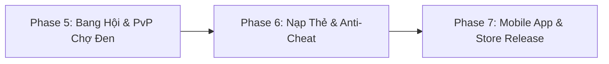

# Anhem JaeBin – Ăn Chơi Điệu Nghệ (JaeBinPlatform)

> **Dự án Game Thẻ Bài Chiến Thuật Tốc Độ Cao (Tactical Web Card Battler / Card RPG) kết hợp Hệ Thống Web Portal (Sự kiện, Gacha, Bang Hội, Nạp thẻ)**  
> *Slogan: "Đấu bài đỉnh cao – Phong cách ngầu lòi – Ăn chơi điệu nghệ"*  
> **Nền tảng công nghệ**: Next.js 16 (React 19) • NestJS Fastify • PostgreSQL 16 • Prisma ORM • Redis 7 • Harness Engineering Framework (HEF v4.0.0)

[](file:///f:/project/repo-github/JaeBinPlatform/harness-engineering/CONSTITUTION.md)
[](https://www.typescriptlang.org/)
[](https://nextjs.org/)
[](https://nestjs.com/)
[](https://www.prisma.io/)

---

## 📌 1. Tổng quan dự án

**Anhem JaeBin** là game thẻ bài chiến thuật thế hệ mới chạy mượt mà ngay trên mọi trình duyệt web (Desktop, Tablet & Mobile Web) với đồ họa **Acid Cyber & Street Neo-Brutalism**. Game được tổ chức theo mô hình **Monorepo** và kiến trúc **Docs-as-Code**, quản lý chất lượng theo khung chuẩn **Harness Engineering Framework v4.0.0**.

### 🌟 Tính năng gameplay nổi bật đã hoàn thiện
1. **Đấu trường Đội hình 6 Thẻ Bài & 6 Ô Trang Bị**:
   - Vị trí chiến thuật: **Tiền Tuyến** (2 Đỡ đòn/Phá giáp), **Hàng Giữa** (3 Sát thương chủ lực/Ám sát/Gây độc), **Hàng Sau** (1 Hồi phục/Khiên/Buff phong cách).
   - Mỗi thẻ trang bị đủ 6 vị trí: **Vũ Khí, Áo Khoác, Quần, Sneaker, Phụ Kiện, Xe Độ**.
   - Phân cấp 7 bậc phẩm chất trang bị: `Common` $\to$ `Fine` $\to$ `Rare` $\to$ `Epic` $\to$ `Legendary` $\to$ `Mythic` $\to$ **`Sovereign` (Độc Tôn Server / 1-of-1)**.
2. **Hiệu ứng Kích hoạt Bộ Trang Bị (Set Resonance)**:
   - Gắn đủ bộ 2, 4 hoặc 6 món cùng rank nhận thêm từ **+800 CP** đến **+180,000 CP**, cùng % ATK, DEF và HP cực đại.
3. **Tiến Hóa 3 Cảnh Giới Đột Phá (Hero Ascension)**:
   - ⭐ **Cảnh Giới Tinh Tú**: 1★ $\to$ 6★ (Level 1 - 40).
   - 🌙 **Cảnh Giới Huyền Nguyệt**: 1🌙 $\to$ 6🌙 (Level 41 - 70).
   - ☀️ **Cảnh Giới Thái Dương**: 1☀️ $\to$ 6☀️ (Level 71 - 100, mở khóa hào quang **6 THÁI DƯƠNG TỐI CAO** tỏa sáng hoàng kim).
4. **Hệ Thống 6 Kỹ Năng Tự Động & 5 Trường Phái Chiến Thuật (Team Archetypes)**:
   - Tướng tự động kích hoạt chiêu thức theo lượt và nộ khí:
     - 🧪 **Độc Bào Mòn (Poison Corrosion)**: Xếp chồng độc dược, sát thương liên tục theo % HP Boss.
     - 💥 **Chí Mạng Hypercarry (Crit Burst / Execute)**: Dồn nộ, trảm sát đơn mục tiêu hoặc bộc phá diện rộng.
     - 🛡️ **Phản Đòn Tạo Khiên (Shield Counter)**: Hấp thụ đòn đánh, phản kích sát thương tương đương 200% giáp.
     - 🌀 **Khống Chế Suy Nhược (Control Weaken)**: Choáng váng, giảm 40% công kích Boss.
     - 💖 **Bất Tử Giải Hiệu Ứng (Immortal Cleanse)**: Hồi máu toàn đội kết hợp khiên hộ thể hoặc ban trạng thái **Bất Tử (HP không thể tụt dưới 1)**.
5. **Thanh Style "Ăn Chơi Điệu Nghệ" (D $\to$ SSS) & Hợp Kích All-Out Resonance**:
   - Tích lũy chuỗi combo để đẩy Style Meter lên hạng **SSS**, kích hoạt hợp kích toàn màn hình 6 thẻ bài giáng sát thương hủy diệt.
6. **Chiến Dịch 10 Chương 100 Ải & 4 Boss Khung Giờ**:
   - Vượt ải tự động lưu tiến trình, mở khóa phó bản và Boss địa bàn.
   - Săn Boss thế giới theo khung giờ (12h, 18h, 20h, 22h) đua Top Lực Chiến nhận rương báu Sovereign.
7. **Lò Rèn (Anvil) & Gacha Đa Tầng**:
   - Cường hóa trang bị (+1 đến +20), Dung luyện 3 món cùng phẩm chất lên bậc cao hơn, Phân giải trang bị thừa.
   - Mở hòm Gacha 5 cấp độ (Đồng, Bạc, Vàng, Mythic, Sovereign) và Chiêu Mộ Tướng từ Common tới Sovereign.
8. **Đồng Bộ Dữ Liệu Thời Gian Thực với PostgreSQL**:
   - Lưu trữ an toàn nhân vật, túi đồ, đội hình, tính toán AFK offline server-side chống hack.

---

## 🏗️ 2. Cấu trúc Monorepo

```text
JaeBinPlatform/
├── docs/                      # Nguồn sự thật (Source of Truth) cho toàn bộ game
│   ├── 00-vision/             # Tầm nhìn, định vị thương hiệu, Bento Grid UI 2026
│   ├── 01-specs/              # Đặc tả chi tiết từng tính năng (FEAT-001 đến FEAT-016)
│   ├── 02-architecture/       # Kiến trúc Client-Server, Database schema, API docs
│   ├── 03-art-pipeline/       # Hướng dẫn tạo hình Card Art, Khung thẻ theo Rank từ AI
│   ├── 04-qa/                 # Kịch bản kiểm thử, test suite và edge cases
│   └── 05-operations/         # Quy trình triển khai, backup database và monitoring
├── apps/                      # Các ứng dụng frontend
│   ├── web-portal/            # Next.js 16 Web Card Game, Đấu trường, Gacha & Portal
│   └── mobile-client/         # Mobile Client scaffolding (Unity / PWA Capacitor)
├── services/                  # Các dịch vụ backend
│   └── game-backend/          # NestJS Fastify API, Prisma PostgreSQL, Auth, Combat, AFK
├── data/                      # Dữ liệu bảng số cân bằng game
│   ├── items/                 # Bảng đặc tả 100+ trang bị, bộ set và chỉ số
│   └── events/                # Cấu hình sự kiện Boss thế giới, Carnival và Giftcode
├── infra/                     # Hạ tầng container (Docker Compose, PostgreSQL, Redis)
├── harness-engineering/       # Khung chuẩn kỹ thuật HEF v4.0.0, Roles, Scripts, CLI
├── scripts/                   # Bộ công cụ Python xử lý asset, hình ảnh và data seed
├── AGENTS.md                  # Quy chuẩn phát triển dành cho Solo Dev + AI Synergy
└── README.md                  # Tài liệu tổng quan dự án
```

---

## 🛠️ 3. Tech Stack cốt lõi

| Phân hệ | Công nghệ | Mục đích sử dụng |
| :--- | :--- | :--- |
| **Web Portal & Card Game** | **Next.js 16 (App Router), React 19, TypeScript** | Giao diện web chạy mượt mà mọi thiết bị, Turbopack biên dịch siêu tốc, hỗ trợ PWA. |
| **Styling & Hiệu ứng Thẻ** | **Tailwind CSS, Canvas Confetti, Web Audio API** | Giao diện Acid Cyber & Bento Grid, hiệu ứng viền sáng Rank, âm thanh đòn đánh sống động. |
| **Backend Service** | **NestJS 10, Fastify Adapter** | API hiệu năng cao, xử lý tính toán combat, AFK, quản lý túi đồ, auth JWT. |
| **Database & ORM** | **PostgreSQL 16, Prisma ORM 6** | Cơ sở dữ liệu quan hệ với ràng buộc ACID chặt chẽ, seed 50 tướng và trang bị đầy đủ. |
| **Caching & In-Memory** | **Redis 7** | Cache phiên đăng nhập, Leaderboard Đua Top CP realtime. |
| **DevOps & Containers** | **Docker, Docker Compose** | Khởi chạy 1 lệnh cụm PostgreSQL + Redis + Backend. |
| **Engineering Governance**| **Harness Engineering Framework (HEF v4.0.0)** | Quy chuẩn rủi ro (Risk lanes), Story verification, Trace log, Constitution bất biến. |

---

## 🚀 4. Lộ trình phát triển (Roadmap)

### ✅ Đã hoàn thành (Phase 1 – Phase 4)
- [x] **Phase 1: Web Card Battler Core**:
  - Đội hình 6 thẻ bài, 6 ô trang bị, thanh Style D $\to$ SSS, All-Out Resonance.
- [x] **Phase 2: Game Backend & Production Database**:
  - NestJS Fastify + Prisma ORM + PostgreSQL/SQLite, Auth JWT, đồng bộ GameState, API trang bị/tháo đồ và tính toán lực chiến chuẩn mực.
- [x] **Phase 3: Đại Mở Rộng 10 Chương, 50 Tướng & Sự Kiện Khung Giờ**:
  - 10 chương 100 ải, kho 50 tướng, 4 Boss khung giờ, Đua top CP, Gacha 5 cấp độ và Lò Rèn Cường Hóa / Dung Luyện / Phân Giải.
- [x] **Phase 4: Đa Dạng Chiến Thuật, Cảnh Giới Thái Dương & Live CP Scaling**:
  - 5 trường phái chiến thuật (Độc, Trảm Sát, Khiên, Choáng, Bất Tử), hệ thống Tiến Hóa 3 Cảnh Giới (Sao $\to$ Nguyệt $\to$ Thái Dương), 6 kỹ năng tự động, 6 Boss thế giới mới, và tính năng trang bị tăng chiến lực tức thì kèm hiệu ứng Set Resonance.

---

### 🔮 Kế hoạch các Phase tiếp theo (Next Phases)



#### 🛡️ Phase 5: Bang Hội Đua Top, PvP Thời Gian Thực & Chợ Đen Đấu Giá (Guild Wars, Live Arena & Black Market)
- **Hệ thống Bang Hội (Guilds)**:
  - Thành lập bang hội, đóng góp quỹ bang, cây kỹ năng bang hội buff chỉ số toàn đội.
  - Săn **Boss Bang Hội (Guild Raid)** quy mô lớn, BXH sát thương bang hội hàng tuần.
- **Đấu Trường PvP Thời Gian Thực (Live Arena / Ranked)**:
  - Ghép trận PvP đối kháng 1v1 theo ELO, cấm/chọn (Ban/Pick) trường phái chiến thuật.
  - Mùa giải PvP nhận danh hiệu độc quyền và khung thẻ bài Vinh Dự.
- **Chợ Đen Đấu Giá (Black Market Trading)**:
  - Sàn giao dịch trang bị giới hạn (1-of-1, 10-of-10) giữa người chơi thông qua Vàng và Kim Cương.

#### 💳 Phase 6: Cổng Thanh Toán Thực Tế (Payment Gateway) & Bảo Mật Anti-Cheat
- **Cổng Nạp Đa Kênh Tích Hợp**:
  - Kết nối cổng thanh toán trực tiếp: **MoMo, VNPay, ZaloPay, VietQR, Thẻ Cào**.
  - Xử lý Webhook Idempotency chống nạp trùng lặp giao dịch (Zero Duplicate Guarantee).
- **Hardening Bảo Mật Server-side**:
  - Server-side Replay Verification: Ghi nhận chuỗi thao tác và tính toán lại kết quả trận đánh trên server để ngăn chặn hack client (Speed hack, Memory inject).
  - Rate limiting và kiểm soát tải DDoS với Redis.

#### 📱 Phase 7: Mobile App Native / Unity Client & Phát Hành Ứng Dụng
- **Mobile Client (Unity / PWA Native Wrapper)**:
  - Đóng gói ứng dụng di động Android (.apk) và iOS (.ipa) thông qua Unity hoặc Capacitor PWA.
  - Hỗ trợ Touch Haptics (rung phản hồi lực khi ra đòn bạo kích), Push Notification nhắc nhở khung giờ săn Boss.
  - Đăng nhập sinh trắc học một chạm (FaceID, Vân tay).

---

## 💻 5. Hướng dẫn cài đặt & Khởi chạy cục bộ (Local Setup)

### Yêu cầu môi trường
- **Node.js**: v20.x hoặc v22.x LTS
- **Python**: 3.9+ (chạy Harness CLI và scripts)
- **Docker & Docker Compose** (tùy chọn nếu dùng cơ sở dữ liệu container)

### Bước 1: Khởi động Cơ sở dữ liệu & Backend
```bash
# 1. Khởi động PostgreSQL và Redis bằng Docker (hoặc dùng SQLite mặc định)
cd infra
docker-compose up -d
cd ..

# 2. Cài đặt và khởi chạy Game Backend
cd services/game-backend
npm install
npx prisma db push
npx prisma db seed
npm run start
# Backend chạy tại: http://localhost:3001
```

### Bước 2: Khởi động Web Portal Client
```bash
# Mở một terminal mới tại thư mục gốc:
cd apps/web-portal
npm install
npm run dev
# Web Portal chạy tại: http://localhost:3000
```

---

## 📖 6. Mục lục tài liệu Nguồn Sự Thật (Docs Source of Truth)

| Tài liệu | Nội dung chi tiết |
| :--- | :--- |
| [vision.md](file:///f:/project/repo-github/JaeBinPlatform/docs/00-vision/vision.md) | Tầm nhìn, triết lý thiết kế và phong cách thẩm mỹ Bento Grid 2026. |
| [system-architecture.md](file:///f:/project/repo-github/JaeBinPlatform/docs/02-architecture/system-architecture.md) | Kiến trúc tổng thể Client-Server, luồng dữ liệu và lược đồ Database. |
| [CONSTITUTION.md](file:///f:/project/repo-github/JaeBinPlatform/harness-engineering/CONSTITUTION.md) | Bộ luật bất biến của dự án: Docs-first, Bảo mật giao dịch, Anti-cheat. |
| [FEAT-001](file:///f:/project/repo-github/JaeBinPlatform/docs/01-specs/FEAT-001-combat-style.md) | Chiến đấu thẻ bài & Thanh Style Meter "Ăn Chơi Điệu Nghệ". |
| [FEAT-002](file:///f:/project/repo-github/JaeBinPlatform/docs/01-specs/FEAT-002-afk-idle-boss.md) | Hệ thống treo máy AFK viễn chinh đánh Boss. |
| [FEAT-003](file:///f:/project/repo-github/JaeBinPlatform/docs/01-specs/FEAT-003-item-combat-power.md) | Công thức chuẩn hóa tính Lực Chiến Trang Bị & Thẻ bài. |
| [FEAT-008](file:///f:/project/repo-github/JaeBinPlatform/docs/01-specs/FEAT-008-backend-database-production-ready.md) | Thiết kế Database PostgreSQL, Prisma ORM và kiến trúc NestJS. |
| [FEAT-012](file:///f:/project/repo-github/JaeBinPlatform/docs/01-specs/FEAT-012-mega-expansion-10-chapters-50-heroes-events.md) | Bản đồ 10 Chương 100 Ải, Roster 50 Tướng và Sự Kiện Boss Khung Giờ. |
| [FEAT-013](file:///f:/project/repo-github/JaeBinPlatform/docs/01-specs/FEAT-013-hero-ascension-stars-moons-suns.md) | Tiến hóa tướng 3 Cảnh Giới: ⭐ Tinh Tú $\to$ 🌙 Huyền Nguyệt $\to$ ☀️ Thái Dương. |
| [FEAT-015](file:///f:/project/repo-github/JaeBinPlatform/docs/01-specs/FEAT-015-six-skills-archetypes-sovereign-expansion.md) | 6 Kỹ năng tự động, 5 Trường phái chiến thuật và Danh sách tướng Sovereign. |
| [FEAT-016](file:///f:/project/repo-github/JaeBinPlatform/docs/01-specs/FEAT-016-tactical-combat-equipment-rebalance-boss-expansion.md) | Cơ chế chiến thuật (Trảm sát, Khiên, Bất tử), Cân bằng trang bị và 6 Boss mới. |

---

## ⚙️ 7. Quy trình kỹ thuật Harness Engineering Framework (HEF)

Dự án áp dụng chặt chẽ quy trình **Harness CLI** để nghiệm thu tính năng và ghi lại Trace phát triển:
```bash
# Xem ma trận tiến độ các User Stories
python harness-engineering/scripts/harness_cli.py query matrix

# Thêm User Story mới (Risk Lane: normal / high_risk)
python harness-engineering/scripts/harness_cli.py story add --id US-032 --title "Guild Raid Boss" --lane normal

# Nghiệm thu tự động User Story bằng test build
python harness-engineering/scripts/harness_cli.py story verify US-032 --command "npm run build" --result pass

# Ghi lại Trace tiến độ phát triển
python harness-engineering/scripts/harness_cli.py trace --summary "Hoàn thành nghiệm thu US-032" --outcome completed
```

---

## 🤝 8. Tác giả & Giấy phép

- **Trưởng dự án**: [Masterltb](https://github.com/Masterltb) (Solo Dev + AI Synergy with Antigravity AI)
- **Repository**: [https://github.com/Masterltb/jb-platform](https://github.com/Masterltb/jb-platform)
- **Bản quyền**: © 2026 Anhem JaeBin Studio. Mọi quyền được bảo lưu.
