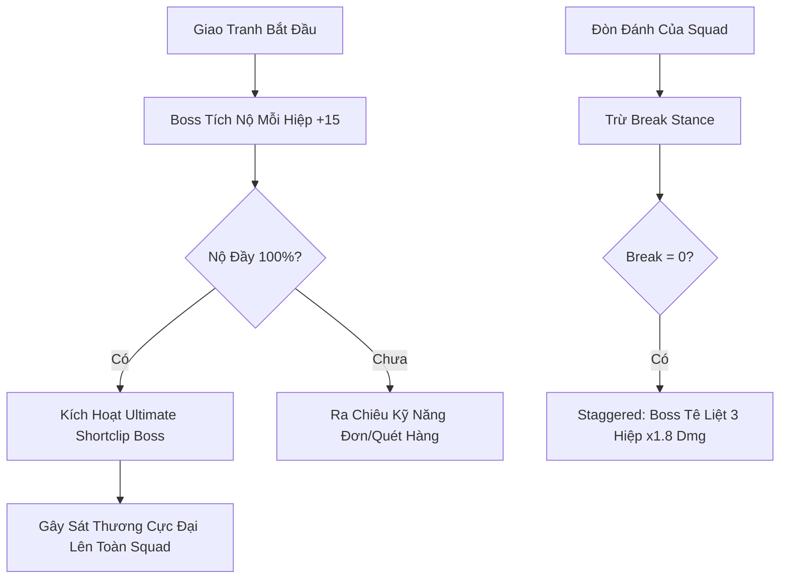

# FEAT-004: Đặc Tả Hệ Thống Quái Vật, Thủ Lĩnh & Sư Đà Yêu Lĩnh (Monsters & Bosses)

> **Dự án**: JaeBinPlatform (Anhem JaeBin – Ăn Chơi Điệu Nghệ)  
> **Trạng thái**: Production Ready (Approved)  
> **Phiên bản**: v1.0.0  
> **Lane**: normal / high_risk (Boss Drop Calculation)  

---

## 1. Tổng Quan Kiến Trúc Boss & Quái

Hệ thống giao tranh Boss trong Anhem JaeBin được thiết kế theo phong cách Web Card Auto-Combat 2026 kết hợp **Break Stance Engine** và **Cinematic Ultimate Shortclip**.

### 1.1 Cơ Chế Thanh Máu & Thế Trận (Dual Bar System)
1. **HP Bar (Thanh Máu Đỏ/Cam)**: Máu thực tế của Boss. Khi về 0, Boss bị hạ gục.
2. **Break Bar / Giáp Vỡ (Thanh Trắng/Vàng)**:
   - Khi nhận sát thương từ các thẻ bài hoặc đòn đánh thường, thanh Break giảm dần.
   - Khi Break = 0: Boss rơi vào trạng thái **Staggered (Choáng váng 3 hiệp)**, phòng ngự giảm 50%, sát thương nhận vào x1.8, hủy toàn bộ lượt niệm chiêu Enrage.

---

## 2. Danh Sách 4 Chế Độ Săn Boss (Boss Hub)

Theo đúng giao diện trung tâm **Săn Boss (Hub)**:

| Chế độ | Giới hạn lượt | Năng lượng tiêu hao | Phần thưởng đặc trưng |
| :--- | :--- | :--- | :--- |
| **Sư Đà Yêu Lĩnh** | 3/6 lượt ngày | 20 Năng lượng | Mảnh Thần Khí 1-of-1, Đá Cường Hóa Bậc 8, Tinh Thể Long Hồn |
| **Yêu Vương Riêng** | 5 lượt/ngày | 10 Năng lượng | Đồ Cam (Legendary), Mũ & Giày Set Lôi Thần, Vàng x50,000 |
| **Boss Server** | 12:00 & 21:00 | Miễn phí | Rương Jackpot Đấu Giá Server, Danh Hiệu Độc Tôn, 5,000 KC |
| **Boss Bổn Tông** | 2 lần/tuần | Bang hội mở | Điểm Cống Hiến Tông Môn, Khí Linh Thần Thú, Bùa May Mắn |

---

## 3. Danh Sách 6 Boss Trọng Điểm & Chỉ Số Cân Bằng

### 3.1 Cửu Linh Thị Xà (Sư Đà Yêu Lĩnh - 6 Chuyển) — World Class Boss
- **Tước hiệu**: Xà Thần Chín Đầu Thượng Cổ Thức Tỉnh  
- **Cấp độ yêu cầu**: Level 85+ (Khuyên dùng CP: 450,000+)  
- **Chỉ số căn bản**:
  - HP: 8,500,000
  - Giáp Phá Vỡ (Break Bar): 1,200,000
  - Công Kích (ATK): 38,500
  - Phòng Ngự (DEF): 18,200
  - Tốc Độ: 110
- **Bộ Kỹ Năng**:
  1. *Độc Vụ Phong Thiên*: Phun khói độc diện rộng, gây debuff Rút Máu 5% HP tối đa mỗi hiệp trong 3 hiệp.
  2. *Cửu Đầu Lôi Phạt (Ultimate Shortclip)*: Toàn màn hình rung chuyển, 9 đầu rắn ngưng tụ sấm sét màu tím đen giáng xuống, gây 180% ATK xuyên 30% giáp.
  3. *Huyết Mạch Tái Sinh (Bị động)*: Dưới 30% HP, tăng 40% Tốc độ và 20% Hút máu.
- **Tỉ Lệ Rớt Đồ (Drop Rate Table)**:
  - Rương Mảnh Hắc Long Độc Tôn (1-of-1): 0.05%
  - Trang Bị Lôi Thần Cyber (10-of-10): 1.5%
  - Trang Bị Thần Ưng Viễn Đông (Legendary): 8.0%
  - Đá Cường Hóa Cao Cấp: 100% (x10 ~ x20)
  - Vàng: 150,000 ~ 300,000

---

### 3.2 Đại Ca Phố Cổ (Bụi Đời Chợ Lớn) — Boss Mở Đầu
- **Tước hiệu**: Trùm Bảo Kê Băng Đảng Đêm Trắng  
- **Cấp độ**: Level 25 (Khuyên dùng CP: 65,000+)  
- **Chỉ số**:
  - HP: 450,000 | Break: 80,000 | ATK: 4,800 | DEF: 2,100
- **Kỹ năng**:
  - *Gậy Bóng Chày Gia Cố*: Đập mạnh đơn mục tiêu hàng trước, làm choáng 1 hiệp.
  - *Hú Gọi Đàn Em (Ultimate Shortclip)*: Huýt sáo gọi 4 tên Ninja Bụi Đời hỗ trợ tấn công dồn dập.
- **Drop**: Set Đồ Bạc (Fine ~ Rare), 25,000 Vàng, 50 Kim Cương.

---

### 3.3 Lão Hạc Cyber (Chợ Đen Ngầm) — Boss Trung Cấp
- **Tước hiệu**: Lãnh Chúa Buôn Lậu Vũ Khí Tối Tân  
- **Cấp độ**: Level 45 (Khuyên dùng CP: 150,000+)  
- **Chỉ số**:
  - HP: 1,850,000 | Break: 280,000 | ATK: 12,500 | DEF: 6,400
- **Kỹ năng**:
  - *Súng Plasma 6 Nòng*: Xả đạn hàng dọc 3 thẻ bài.
  - *Quả Cầu Tự Hủy Neon (Ultimate)*: Ném lựu đạn EMP khóa kỹ năng toàn đội trong 1 hiệp.
- **Drop**: Vũ khí Epic, Phụ Kiện Cyberpunk, 60,000 Vàng.

---

### 3.4 Sư Đà Vương (7 Chuyển - Hắc Ám Cổ Tộc)
- **Tước hiệu**: Vương Giả Sư Đà Đệ Nhất Ma Tông  
- **Cấp độ**: Level 95 (Khuyên dùng CP: 680,000+)  
- **Chỉ số**:
  - HP: 16,000,000 | Break: 2,500,000 | ATK: 65,000 | DEF: 28,000
- **Kỹ năng**:
  - *Sư Hống Tàn Thiên (Ultimate Shortclip)*: Tiếng gầm xé rách không gian, hất văng khiên bảo hộ của Tanker, giảm 40% giáp của toàn đội hình.
  - *Ma Trảo Đoạt Hồn*: Đòn cào chí mạng 250% ATK vào thẻ bài có HP thấp nhất.

---

### 3.5 Kim Bằng Quỷ Vương (8 Chuyển - Chung Cực Thần Thú)
- **Tước hiệu**: Bá Chủ Bầu Trời Thần Cơ  
- **Cấp độ**: Level 110 (Khuyên dùng CP: 1,200,000+)  
- **Chỉ số**:
  - HP: 35,000,000 | Break: 5,000,000 | ATK: 120,000 | DEF: 45,000
- **Drop độc quyền**: Phôi Đúc Thần Khí Sovereign 1-of-1, Tinh Thể Không Gian Cyber.

---

## 4. Cơ Chế Minion Quái Nhỏ Đi Kèm Boss
Trong các ải Boss lớn, Boss luôn có 4 quái phụ đi cùng (vị trí Minion 1 -> 4):
1. **Ninja Hộ Vệ (Tanker)**: Sở hữu khiên chặn 30,000 sát thương cho Boss.
2. **Xạ Thủ Bắn Tỉa Neon (DPS)**: Tấn công thẻ bài hàng sau của người chơi mỗi khi Boss bị đánh trúng.
3. **Thợ Máy Tiếp Ứng (Support)**: Hồi phục 2% HP cho Boss mỗi 2 hiệp nếu không bị tiêu diệt trước.
