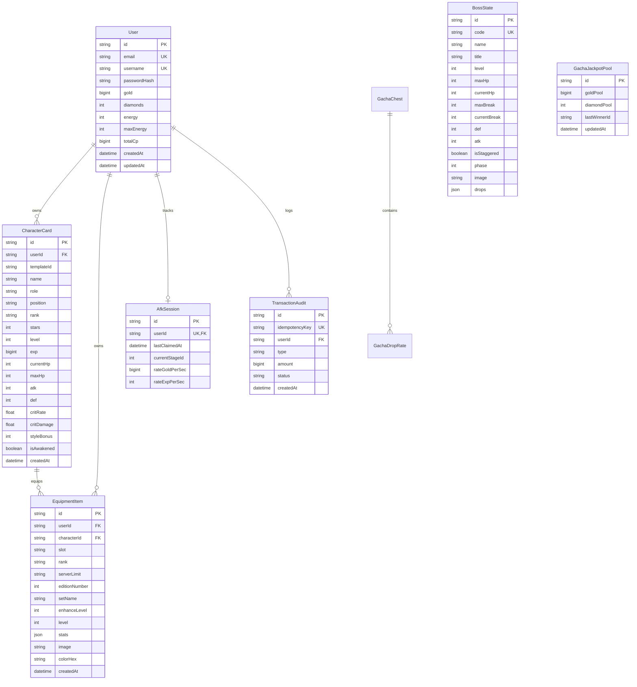

# Spec FEAT-008: Production-Ready Game Backend & PostgreSQL Database Architecture

> **Feature Code**: `FEAT-008`  
> **Risk Lane**: `normal`  
> **Status**: `PROPOSED`  
> **Authors**: JaeBin Core Team & AI Synergy  
> **Surfaces**: `services/game-backend/` & `apps/web-portal/`  
> **Related Specs**: [CONSTITUTION.md](file:///f:/project/repo-github/JaeBinPlatform/harness-engineering/CONSTITUTION.md), [FEAT-001](file:///f:/project/repo-github/JaeBinPlatform/docs/01-specs/FEAT-001-combat-style.md), [FEAT-002](file:///f:/project/repo-github/JaeBinPlatform/docs/01-specs/FEAT-002-afk-idle-boss.md), [FEAT-003](file:///f:/project/repo-github/JaeBinPlatform/docs/01-specs/FEAT-003-item-combat-power.md), [FEAT-007](file:///f:/project/repo-github/JaeBinPlatform/docs/01-specs/FEAT-007-production-ready-dashboards-and-balance.md)

---

## 🎯 1. MỤC TIÊU CỐT LÕI (OBJECTIVES)
Chuyển đổi toàn bộ hệ thống từ dữ liệu tĩnh (Mock Data) sang **Kiến Trúc Backend & Database chuẩn Production Ready 100%**:
1. **Loại bỏ hoàn toàn mock data**: Mọi thông số người chơi, 6 thẻ tướng trong đội hình, 6 ô trang bị, kết quả quay Gacha, chỉ số Boss và lượng thưởng AFK đều được lưu trữ và thẩm định tại Database.
2. **Server-Side Authority ("Never Trust The Client")**:
   - Tính toán sát thương trận đấu và thanh Break Stance hoàn toàn phía Server.
   - Thu hoạch tài nguyên AFK dựa trên mốc thời gian thực của Server: $\Delta T = \text{ServerNow} - \text{LastClaimedAt}$.
   - Giao dịch Gacha và Nạp thẻ/Nhận quà sử dụng **Idempotency Key** và Database Transactions (ACID) để chống nhân bản đồ hoặc nổ hũ trùng lặp.
3. **Hiệu năng cao & Khả năng chịu tải**:
   - Backend chạy trên **NestJS + Fastify**.
   - Database sử dụng **PostgreSQL** kết hợp Prisma ORM với đầy đủ Foreign Keys, Constraints, Unique Indexes.
   - Cache và Leaderboard thời gian thực (Redis Ready).

---

## 🗄️ 2. THIẾT KẾ DATABASE SCHEMA (PRISMA / POSTGRESQL)

---

## 🚀 3. THIẾT KẾ RESTful API CONTRACTS

### 3.1. Authentication & Profile
- `POST /api/auth/register`: Đăng ký tài khoản mới, tự động khởi tạo đội hình tân thủ (6 thẻ bài) và túi đồ cơ bản.
- `POST /api/auth/login`: Xác thực và trả về JWT Bearer Token.
- `GET /api/user/profile`: Lấy thông tin tài khoản, ví Vàng, Kim Cương, Năng Lượng và Tổng Lực Chiến.

### 3.2. Game State & Squad Management
- `GET /api/game/state`: Tải toàn bộ trạng thái chơi của User: 6 Tướng trong Đội hình, Chi tiết 6 Ô Trang Bị, Kho Túi Đồ, và Trạng thái Trùm hiện tại.
- `POST /api/squad/equip`: Gắn trang bị vào nhân vật (Thẩm định đúng Slot, trừ khỏi Túi, cập nhật lại CP).
- `POST /api/squad/unequip`: Tháo trang bị đưa về Kho túi đồ.

### 3.3. Inventory Forge (Cường Hóa, Lò Ghép & Phân Rã)
- `POST /api/inventory/enhance`:
  - Input: `{ itemId: string }`
  - Logic: Kiểm tra Vàng, tăng `enhanceLevel + 1`, tăng thuộc tính 10%, nạp vào DB.
- `POST /api/inventory/fuse`:
  - Input: `{ itemIds: [string, string, string] }`
  - Logic: Kiểm tra 3 món cùng phẩm, kiểm tra 5,000 Vàng, xóa 3 món nguyên liệu trong Transaction, tạo ra 1 món phẩm cấp tiếp theo theo [FEAT-007](file:///f:/project/repo-github/JaeBinPlatform/docs/01-specs/FEAT-007-production-ready-dashboards-and-balance.md).
- `POST /api/inventory/dismantle`:
  - Input: `{ itemIds: string[] }`
  - Logic: Chặn trang bị 1-of-1 Sovereign, xóa danh sách trang bị, hoàn trả Vàng, Kim Cương, Đá Cường Hóa vào ví.

### 3.4. Server-Side Combat & Boss Hub
- `GET /api/boss/tiers`: Lấy danh sách 3 Đại Boss Thế Giới (Sư Đà Vương, Cửu Linh Thị Xà, Kim Bằng Quỷ Vương) và trạng thái HP/Break hiện tại.
- `POST /api/combat/round`:
  - Input: `{ bossId: string, attackerCardId: string, actionType: string }`
  - Output: Tính toán sát thương thực tế theo $\text{mitigation} = \frac{1000}{1000 + \text{DEF}}$, giảm Break Stance, kiểm tra Staggered, trả về floating damage và kết quả trận đấu.

### 3.5. Gacha 3D & Jackpot Vô Cực
- `POST /api/gacha/open`:
  - Input: `{ chestId: string, count: number, idempotencyKey: string }`
  - Logic: Trừ tiền, quay thưởng theo tỷ lệ rơi minh bạch, kiểm tra nổ Hũ Jackpot toàn server, lưu trang bị trúng thưởng vào DB của User.

### 3.6. AFK Idle Expeditions
- `POST /api/afk/claim`:
  - Logic: Lấy `lastClaimedAt` từ DB, tính thời gian $\Delta T$, tính thưởng Vàng và Kim Cương, cập nhật `lastClaimedAt = NOW()` trong cùng 1 Transaction.

---

## 🛡️ 4. CHẤP THUẬN & TIÊU CHÍ NGHIỆM THU (ACCEPTANCE CRITERIA)
- [ ] Dịch vụ `services/game-backend/` khởi động hoàn hảo trên Fastify, cấu hình Prisma schema đầy đủ.
- [ ] File Seed `prisma/seed.ts` nạp sẵn bộ nhân vật, boss, và trang bị chuẩn không thiếu bất kỳ trường nào.
- [ ] Web Portal kết nối và đồng bộ 100% dữ liệu với Backend qua API Client, tự động fallback an toàn nếu mất mạng.
- [ ] Chạy kiểm thử End-to-End kiểm tra tính toàn vẹn của giao dịch Cường Hóa, Dung Luyện và Mở Gacha.
